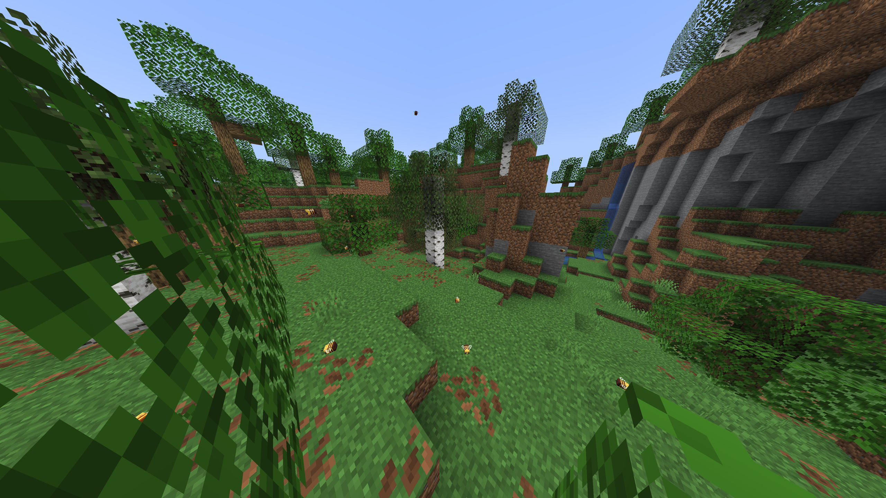
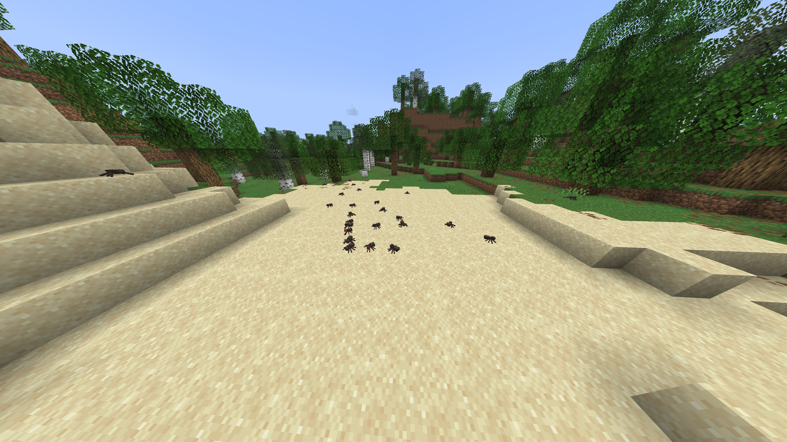
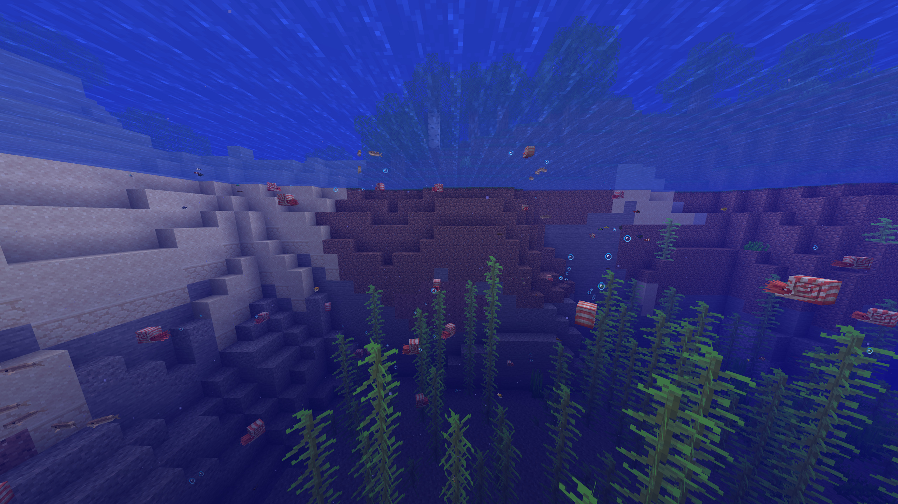
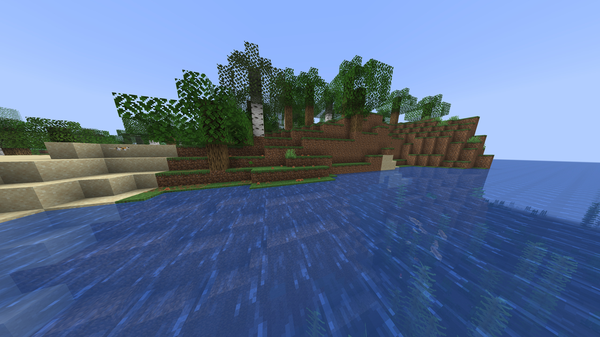
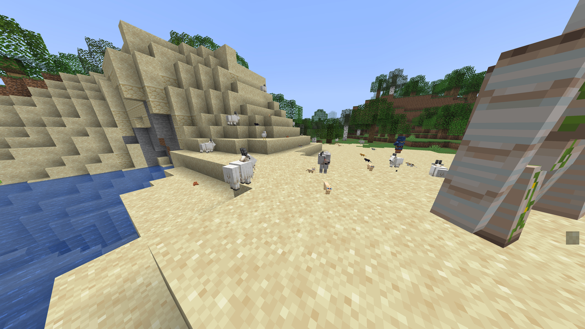
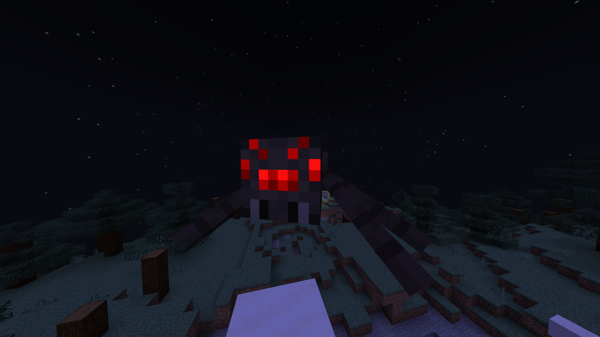
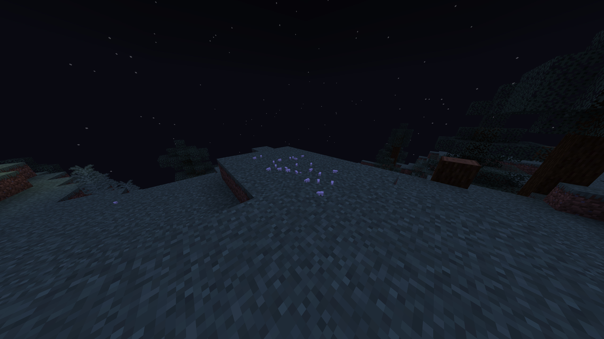

# RealSize screenshots

[Player guide](README.md) · [Configuration](CONFIGURATION.md)

Screenshots by OG moocow. These seven images cover the distinct scenes in the
submitted set; alternate views of the same scenes are omitted. Images are resized
for the documentation, with no brightness or color edits.

The giant spider and miniature polar bears are **custom configuration examples**,
not the default sizes. Exact settings used for those screenshots are not recorded.

## Bees

## Spiders

## Aquatic animals

## Frogs and cats

## Goats, cats and chickens

## Giant spider

**Custom configuration.** The spider is enlarged above its default size.
Enlargements beyond the default limit also require raising `cap`; changing only
an entity rule does not bypass that limit. See [configuration options](CONFIGURATION.md#configuration-file-and-options).

## Miniature polar bears

**Custom configuration.** Polar bears are shrunk rather than using their default
`1.05` rule. The configured `floor` still limits how small active rules can make
them. See [changing sizes](CONFIGURATION.md#change-a-mobs-size).

